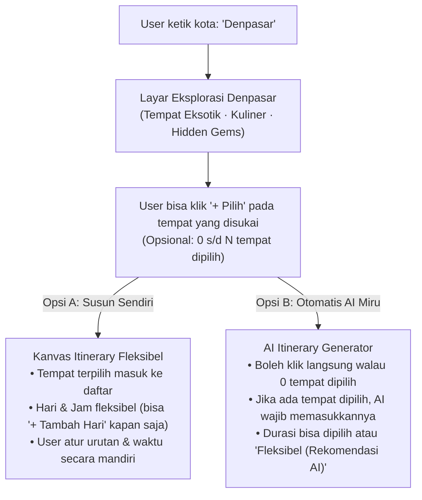

# ADR-001: Paradigma "Explore-First & Flexible Dual-Mode Planning"

- **Status**: Accepted & Implemented
- **Tanggal**: 26 Oktober 2026
- **Konteks Produk**: Miru (`travelmate-web` & `travelmate` Go API)

---

## 1. Latar Belakang & Masalah (Context)

Pada iterasi awal Miru, alur utama memaksa pengguna untuk langsung mengisi parameter kaku di awal (*Kota + Tanggal + Jumlah Hari Pasti + Kelas Budget*), lalu AI langsung menghasilkan jadwal jam-jaman penuh (mis. `08:00` tempat A, `10:00` tempat B).

Pendekatan tersebut menimbulkan 3 friksi utama bagi pengguna:
1. **Terlalu cepat mendikte jadwal**: Saat pengguna mengetik suatu kota (misalnya *"Denpasar"*), mereka sering kali baru ingin melihat **ada opsi menarik apa saja di sana** (tempat eksotis, kuliner khas, budaya/hidden gems), belum siap langsung didikte jam kunjungannya.
2. **Keharusan menentukan jumlah hari di awal**: Banyak pengguna belum tahu berapa hari yang ideal untuk suatu kota sebelum mereka melihat seberapa banyak tempat menarik yang ingin mereka kunjungi di kota tersebut.
3. **Fitur deklaratif tanpa dampak nyata (Theme Pills)**: Deretan *pills* tema (*"Pantai & Laut"*, *"Alam & Petualangan"*, dst.) di halaman utama belum terhubung ke kurasi hasil pencarian sehingga menambah keramaian visual (*clutter*) tanpa fungsi nyata.

---

## 2. Keputusan Arsitektur & UX (Decisions)

### Keputusan 1: Sembunyikan (*Hide*) Theme Pills Sementara
- Deretan *pills* tema (`Pantai & Laut`, `Alam & Petualangan`, `Kota & Kuliner`, `Budaya & Sejarah`, `Relaksasi & Spa`) pada kartu utama Dashboard **disembunyikan** sampai fitur filter kurasi berbasis tema benar-benar diimplementasikan di backend & frontend.
- Kotak *"Mau liburan ke mana?"* hanya fokus pada satu input pencarian kota yang bersih dan tegas ala Uber.

### Keputusan 2: Alur "Explore Kota Dulu → Pilih Tempat → Tentukan Cara Menyusun"
Ketika pengguna mencari sebuah kota (contoh: **Denpasar**), mereka tidak langsung dipaksa membuka modal form durasi/jam, melainkan masuk ke **Layar Eksplorasi Opsi Kota (*City Discovery & Picklist*)**:
- Menampilkan kurasi opsi terbaik di kota tersebut dalam kategori yang mudah dipindai:
  1. **Tempat Eksotik & Ikonik** (*Highlights / Nature / Culture*)
  2. **Kuliner Wajib Coba** (*Culinary Signature*)
  3. **Spot Tersembunyi** (*Hidden Gems*)
- Pengguna dapat **menandai / memilih (`+ Pilih`)** tempat atau kuliner mana saja yang menarik bagi mereka (masuk ke dalam *Trip Bucket / Pilihanmu*), **atau** tidak memilih sama sekali jika ingin menyerahkan 100% ke AI.

### Keputusan 3: Dua Jalur Penyusunan (Opsi A: Mandiri vs Opsi B: Otomatis AI)
Pada *Sticky Bottom Bar* di layar eksplorasi kota, pengguna selalu memiliki 2 pilihan kendali:

### Keputusan 4: Fleksibilitas Jumlah Hari & Jam (Tanpa Harus Tahu Berapa Hari di Awal)
Menjawab masalah *"Bagaimana jika user belum tahu berapa hari yang ingin digunakan?"*:

| Aspek | Opsi A: Susun Sendiri (Mandiri) | Opsi B: Otomatis AI Miru |
| :--- | :--- | :--- |
| **Jumlah Hari di Awal** | **Tidak perlu ditanya di depan.** Kanvas dimulai secara dinamis: semua tempat yang dipilih masuk ke **Hari 1** (atau kantong *Belum Dijadwalkan*). Jika pengguna merasa Hari 1 sudah cukup, mereka cukup klik tombol **`+ Tambah Hari`** (`Hari 2`, `Hari 3`, dst.) sambil jalan. | Tersedia pil **"Fleksibel (Rekomendasi AI)"** selain angka hari `1, 2, 3+`. Jika pengguna memilih *Fleksibel*, AI menghitung jumlah hari optimal berdasarkan jumlah tempat yang dipilih atau standar ideal kota tersebut. |
| **Pengaturan Jam** | **Jam tidak wajib kaku.** Setiap kartu tempat secara default berstatus **"Waktu Fleksibel"** (atau cukup dikelompokkan *Pagi / Siang / Sore / Malam*). Pengguna hanya mengisi jam spesifik (mis. `10:00`) jika mereka memang menginginkannya. | AI menyusunkan estimasi waktu (`Pagi / Siang / Sore / Malam` beserta jam) dan mengurutkan rute yang searah di peta, namun tetap bisa diubah pengguna setelah selesai. |
| **Syarat Memilih Tempat** | Minimal memilih 1 tempat dari daftar (atau mulai dari kanvas kosong lalu klik `+ Aktivitas`). | **Boleh langsung klik** meskipun 0 tempat dipilih (AI pilihkan 100%), atau menyertakan tempat-tempat yang sudah dicentang pengguna. |

---

## 3. Implikasi Teknis (Technical Impact)

1. **Pemanfaatan Endpoint Backend yang Sudah Ada**:
   - Endpoint `GET /api/v1/discovery?city={nama_kota}` di [`trips_handler.go`](file:///Users/dhaniwid/Documents/01.%20Personal/00.%20BUSINESS/1.%20TRAVELMATE/sourcecode/travelmate/internal/http/handlers/trips_handler.go#L404) sudah mendukung pengambilan data *Highlights*, *CulinarySignature*, dan *HiddenGem* untuk kota mana pun (dengan *caching* PostgreSQL di tabel `destinations`).
2. **Penyesuaian Payload Pembuatan Trip (`POST /api/v1/trips`)**:
   - Untuk **Opsi A (Susun Sendiri)**: Kita dapat langsung menyimpan trip dengan daftar aktivitas pilihan pengguna (`itinerary_status = 'completed'`) tanpa perlu menunggu proses *AI streaming* 20 detik! Pengguna langsung masuk ke kanvas `/trips/[id]` dalam < 1 detik untuk mengatur sendiri hari dan waktunya.
   - Untuk **Opsi B (Otomatis AI Miru)**: Mengirim daftar tempat yang sudah dicentang pengguna (`selected_places: string[]`) ke prompt AI agar AI menyusun jadwal harian yang wajib menyertakan tempat-tempat pilihan pengguna tersebut.

---

## 4. Langkah Selanjutnya: Apakah Perlu Mockup Terlebih Dahulu?

> [!IMPORTANT]
> **Rekomendasi: Ya, kita sangat perlu membuat Mockup Visual Interaktif terlebih dahulu sebelum menyentuh kode aplikasi.**

Karena kita sedang merancang pengalaman inti baru (*City Picklist + Dual Action Bar + Kanvas Hari Fleksibel*), membuat **Mockup Interaktif** terlebih dahulu akan membantu kita memvalidasi 3 layar kunci ini secara visual:
1. **Layar 1 — Dashboard Bersih**: Kotak *"Mau liburan ke mana?"* tanpa *pills* tema.
2. **Layar 2 — Eksplorasi Kota (Contoh: Denpasar)**: Tampilan kartu *Tempat Eksotik* & *Kuliner* dengan tombol `+ Pilih`, serta *Sticky Bar* di bawah yang menampilkan **Opsi A (Susun Sendiri)** dan **Opsi B (Serahkan ke AI Miru)**.
3. **Layar 3 — Kanvas Fleksibel (Opsi A)**: Tampilan saat pengguna mengatur sendiri tempat pilihannya dengan waktu fleksibel dan tombol `+ Tambah Hari` tanpa dipaksa menentukan durasi di awal.
